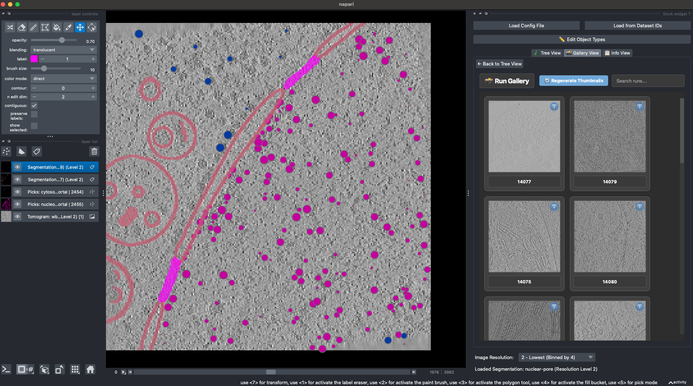

# napari-copick

[](https://github.com/kephale/napari-copick/raw/main/LICENSE)
[](https://pypi.org/project/napari-copick)
[](https://python.org)
[](https://github.com/kephale/napari-copick/actions)
[](https://codecov.io/gh/kephale/napari-copick)
[](https://napari-hub.org/plugins/napari-copick)

A plugin for collaborative annotation in cryoET using copick



----------------------------------

This [napari] plugin was generated with [Cookiecutter] using [@napari]'s [cookiecutter-napari-plugin] template.

<!--
Don't miss the full getting started guide to set up your new package:
https://github.com/napari/cookiecutter-napari-plugin#getting-started

and review the napari docs for plugin developers:
https://napari.org/stable/plugins/index.html
-->

## Installation

You can install `napari-copick` via [pip]:

    pip install napari-copick

To install latest development version:

    pip install git+https://github.com/copick/napari-copick.git

## Usage

### Using a copick config file

```bash
napari-copick run --config path/to/copick_config.json
```

### Using dataset IDs from CZ cryoET Data Portal

```bash
napari-copick run --dataset-ids 10440 10441 --overlay-root /path/to/overlay_root
```

You can specify multiple dataset IDs separated by spaces.

### GUI Usage

The plugin provides an intuitive interface with two loading options:

1. **Load Config File**: Opens a file dialog to select a copick configuration JSON file
2. **Load from Dataset IDs**: Opens a dialog to enter CZ cryoET Data Portal dataset IDs and overlay root path

After loading, you'll see a hierarchical tree of the project structure that you can navigate to access tomograms, segmentations, and picks.

### Painting with CellCanvas and accepting model proposals

*Plugins > copick > Paint and train with CellCanvas* paints a copick reconstruction and turns model output into
annotation only by explicit acceptance. Select a tomogram layer opened by the copick widget, then:

1. **Open painting** adds the painting (a multilabel segmentation on the full-resolution grid, created empty if
   missing). `0` is unknown; background is only ever an explicit class.
2. Paint with napari's label tools and **Save**. A save is refused if the painting was saved elsewhere (for
   example in copick-web) since it was opened; **Undo** reverts the last saved edit from either tool.
3. **Train and predict** uploads the saved painting to a running CellCanvas service
   (`python -m cellcanvas_service`), and shows its completed prediction as a *proposal* layer.
4. **Accept into unknown voxels** copies one proposal class into the painting, optionally only on the current
   slice. Human labels are never overwritten, and a proposal that is incomplete or changed since it was shown is
   refused.

The same operations are available from Python:

```python
import copick
from napari_copick.cellcanvas import CellCanvasService
from napari_copick.painting import Painting

run = copick.from_file("config.json").get_run("TS_001")
painting = Painting.open(run, 10.0, "denoised", "cellcanvas-painting", "kyle", "1")
labels = painting.labels()
labels[40, 100:110, 100:110] = 2
painting.save(labels, painting.revision)

service = CellCanvasService("http://127.0.0.1:8001", "my-dataset")
service.train(painting)
proposal = service.publish(service.predict(), run, 10.0, "cellcanvas-prediction", "cellcanvas", "1")
painting.accept(painting.revision, proposal, proposal_label=2, label=2, digest=proposal.record["digest"])
```

Output written into copick by another tool (for example an nnInteractive object) is accepted the same way after
`Proposal.mark_complete(segmentation, "nninteractive")` records that its write finished.

### Tomogram Handling

napari-copick now handles multiscale zarr arrays directly:

- Automatically detects and loads all available resolution levels
- Creates a proper multiscale image stack using napari's native multiscale API
- Uses dask for efficient lazy loading of large tomogram data
- Applies appropriate scaling factors based on the voxel size metadata

This direct zarr handling provides better performance and more flexibility compared to relying on external plugins.

## Contributing

Contributions are very welcome. Tests can be run with [tox], please ensure
the coverage at least stays the same before you submit a pull request.

## License

Distributed under the terms of the [MIT] license,
"napari-copick" is free and open source software

## Issues

If you encounter any problems, please [file an issue] along with a detailed description.

[napari]: https://github.com/napari/napari
[Cookiecutter]: https://github.com/audreyr/cookiecutter
[@napari]: https://github.com/napari
[MIT]: http://opensource.org/licenses/MIT
[cookiecutter-napari-plugin]: https://github.com/napari/cookiecutter-napari-plugin

[file an issue]: https://github.com/kephale/napari-copick/issues

[napari]: https://github.com/napari/napari
[tox]: https://tox.readthedocs.io/en/latest/
[pip]: https://pypi.org/project/pip/
[PyPI]: https://pypi.org/

## Code of Conduct

This project adheres to the Contributor Covenant [code of conduct](https://github.com/chanzuckerberg/.github/blob/main/CODE_OF_CONDUCT.md). By participating, you are expected to uphold this code. Please report unacceptable behavior to [opensource@chanzuckerberg.com](mailto:opensource@chanzuckerberg.com).

## Reporting Security Issues

If you believe you have found a security issue, please responsibly disclose by contacting us at [security@chanzuckerberg.com](mailto:security@chanzuckerberg.com).
